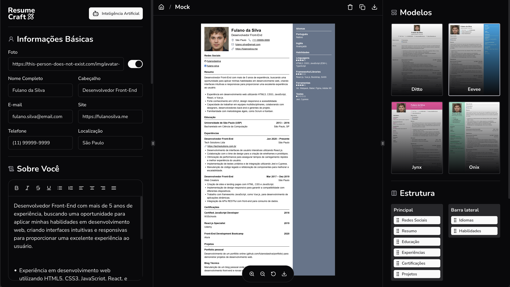

<div align="center">


# Resume Craft

**Crie, edite e exporte currículos profissionais com ajuda de IA.**




</div>

---

## Sumário

- [Funcionalidades](#funcionalidades)
- [Stack](#stack)
- [Arquitetura](#arquitetura)
- [Primeiros passos](#primeiros-passos)
- [Variáveis de ambiente](#variáveis-de-ambiente)
- [Scripts](#scripts)
- [Créditos de IA e pagamentos](#créditos-de-ia-e-pagamentos)
- [Exportação em PDF](#exportação-em-pdf)
- [Deploy](#deploy)
- [Autor](#autor)

## Funcionalidades

- **Autenticação** com GitHub e Google (Auth.js), vinculando contas com o mesmo e-mail.
- **Gestão de currículos**: criar, duplicar e excluir.
- **Editor em tempo real** com pré-visualização, zoom e arrasto do canvas.
- **Rich text** nos campos de conteúdo (Tiptap).
- **Seções reordenáveis** por drag and drop: experiências, formação, certificações e demais seções do currículo.
- **4 templates** (Ditto, Eevee, Kicks e Onix) com cor de destaque personalizável.
- **Geração com IA** (OpenAI `gpt-4.1-mini`):
  - gerar conteúdo a partir do cargo desejado;
  - corrigir ortografia e gramática;
  - traduzir o currículo entre português, inglês, espanhol, francês, alemão e italiano.
- **Créditos de IA** comprados via Stripe Checkout, com saldo e histórico na página da conta.
- **Exportação em PDF** fiel ao template, gerada no servidor com Chromium headless.
- **Landing page** com SEO, `sitemap`, `robots` e Web App Manifest.
- **Tema claro/escuro**.

## Stack

| Camada | Tecnologias |
| --- | --- |
| Framework | Next.js 16 (App Router, Cache Components, React Compiler, Turbopack), React 19 |
| UI | Tailwind CSS 4, shadcn/ui, Radix UI, Lucide, Sonner |
| Formulários | React Hook Form + Zod |
| Estado do servidor | TanStack Query + Axios |
| Banco de dados | PostgreSQL (Supabase) + Drizzle ORM |
| Autenticação | Auth.js (NextAuth v5) + Drizzle Adapter |
| IA | OpenAI SDK |
| Pagamentos | Stripe (Checkout, Webhooks, Billing Portal) |
| PDF | Puppeteer Core + `@sparticuz/chromium` |
| Qualidade | TypeScript, Biome |

## Arquitetura

```
src/
├── app/
│   ├── api/
│   │   ├── auth/             # handlers do Auth.js
│   │   ├── credits/          # saldo, pacotes, checkout e portal de transações
│   │   ├── generate/         # job-title, fix-content, translate (OpenAI)
│   │   ├── resume/download/  # geração do PDF
│   │   └── webhooks/stripe/  # crédito das compras
│   ├── auth/login/           # tela de login
│   ├── dashboard/            # currículos, editor ([id]) e conta
│   └── page.tsx              # landing page
├── components/
│   ├── pages/                # componentes por página (landing, dashboard, editor)
│   └── ui/                   # design system (shadcn/ui)
├── db/                       # schema, migrations, DALs e server actions (Drizzle)
├── lib/                      # clientes: auth, openai, stripe, axios, react-query
├── server/                   # funções de acesso à API usadas no client
└── env.ts                    # validação das variáveis de ambiente (Zod)
openspec/specs/               # especificações funcionais por domínio
```

As especificações de cada domínio (autenticação, editor, créditos, PDF etc.) ficam em [`openspec/specs`](openspec/specs).

## Primeiros passos

### Pré-requisitos

- Node.js 20.9+
- pnpm
- Banco PostgreSQL (o projeto usa Supabase)
- Contas na OpenAI e no Stripe
- Apps OAuth no GitHub e no Google
- [Stripe CLI](https://docs.stripe.com/stripe-cli) para testar webhooks localmente

### Instalação

```bash
git clone git@github.com:hfmelodev/resume-craft.git
cd resume-craft
pnpm install
```

Crie o arquivo `.env` na raiz (veja [Variáveis de ambiente](#variáveis-de-ambiente)) e aplique as migrations:

```bash
pnpm db:migrate
```

Rode o servidor de desenvolvimento:

```bash
pnpm dev
```

Acesse [http://localhost:3000](http://localhost:3000).

Para receber os eventos de pagamento localmente, em outro terminal:

```bash
pnpm webhook
```

Copie o `whsec_...` exibido pela Stripe CLI para `STRIPE_WEBHOOK_SECRET`.

## Variáveis de ambiente

Todas são validadas na inicialização por [`src/env.ts`](src/env.ts). A aplicação não sobe se alguma estiver ausente ou inválida.

| Variável | Descrição |
| --- | --- |
| `DATABASE_URL` | URL do Postgres via pooler (modo Transaction, porta `6543`), usada pela aplicação |
| `DIRECT_URL` | URL do Postgres em modo Session (porta `5432`), usada pelo `drizzle-kit` |
| `NEXT_PUBLIC_APP_URL` | URL pública da aplicação (ex.: `http://localhost:3000`) |
| `AUTH_SECRET` | Segredo do Auth.js (`npx auth secret`) |
| `AUTH_GITHUB_ID` / `AUTH_GITHUB_SECRET` | Credenciais do OAuth App do GitHub |
| `AUTH_GOOGLE_ID` / `AUTH_GOOGLE_SECRET` | Credenciais do OAuth Client do Google |
| `OPENAI_API_KEY` | Chave da API da OpenAI |
| `STRIPE_SECRET_KEY` | Chave secreta do Stripe |
| `STRIPE_CREDIT_PRODUCT_ID` | ID do produto Stripe que agrupa os pacotes de créditos |
| `STRIPE_WEBHOOK_SECRET` | Segredo de assinatura do endpoint de webhook |

Callbacks OAuth em desenvolvimento:

- GitHub: `http://localhost:3000/api/auth/callback/github`
- Google: `http://localhost:3000/api/auth/callback/google`

## Scripts

| Comando | Descrição |
| --- | --- |
| `pnpm dev` | Servidor de desenvolvimento |
| `pnpm build` | Build de produção |
| `pnpm start` | Servidor de produção |
| `pnpm lint` | Lint e checagem com Biome |
| `pnpm format` | Formata o código com Biome |
| `pnpm webhook` | Encaminha eventos do Stripe para `/api/webhooks/stripe` |
| `pnpm db:generate` | Gera migrations a partir do schema |
| `pnpm db:migrate` | Aplica as migrations |
| `pnpm db:sync` | Gera e aplica migrations |
| `pnpm db:push` | Sincroniza o schema direto no banco (sem migration) |
| `pnpm db:studio` | Abre o Drizzle Studio |

## Créditos de IA e pagamentos

1. Cada geração de IA bem-sucedida debita **1 crédito**. O débito é atômico e condicionado ao saldo, então o saldo nunca fica negativo. Sem créditos, as rotas `POST /api/generate/*` respondem `403` sem chamar a OpenAI.
2. Os pacotes são os **preços ativos** do produto `STRIPE_CREDIT_PRODUCT_ID`. A quantidade de créditos de cada pacote vem da metadata `amount` do preço. Preços sem `amount` válido são ignorados.
3. A compra usa Stripe Checkout. Os créditos são somados pelo webhook nos eventos `checkout.session.completed` e `checkout.session.async_payment_succeeded` (pagamentos assíncronos, como Pix e boleto).
4. O webhook verifica a assinatura e é idempotente: cada sessão de checkout é registrada em `processedCheckoutSession` na mesma transação do crédito.
5. O histórico de transações abre o Stripe Billing Portal do cliente.

### Configurando os pacotes no Stripe

1. Crie um produto (ex.: "Créditos de IA") e copie o ID para `STRIPE_CREDIT_PRODUCT_ID`.
2. Adicione um preço por pacote, com a metadata `amount` igual à quantidade de créditos (ex.: `amount = 10`).
3. Ative o Customer Portal em **Settings → Billing → Customer portal**.

## Exportação em PDF

A rota `POST /api/resume/download` renderiza o HTML do currículo com Tailwind e gera o PDF em um Chromium headless:

- **Local:** usa o Chromium do pacote `puppeteer`.
- **Produção (Vercel):** usa `puppeteer-core` com `@sparticuz/chromium`. Os binários entram no bundle da função via `outputFileTracingIncludes` em [`next.config.ts`](next.config.ts).

## Deploy

O projeto foi pensado para a [Vercel](https://vercel.com):

1. Importe o repositório na Vercel.
2. Cadastre todas as [variáveis de ambiente](#variáveis-de-ambiente), com `NEXT_PUBLIC_APP_URL` apontando para o domínio de produção.
3. Atualize os callbacks OAuth do GitHub e do Google para o domínio de produção.
4. Crie um endpoint de webhook no Stripe para `https://<seu-dominio>/api/webhooks/stripe` com os eventos `checkout.session.completed` e `checkout.session.async_payment_succeeded`. Use o segredo gerado em `STRIPE_WEBHOOK_SECRET`.
5. Aplique as migrations no banco de produção com `pnpm db:migrate`.

## Autor

Feito por **Hilquias Ferreira Melo**: [hfmelo.dev](https://hfmelo.dev) · [contato@hfmelo.dev](mailto:contato@hfmelo.dev)
